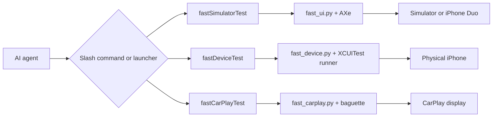

<div align="center">
  
  <h1>fast-ios-device-test</h1>
  <p><strong>Fast, repeatable iOS UI-flow verification for AI coding agents.</strong></p>
  <p>One JSON flow. Simulator, iPhone, iPhone Duo, or CarPlay. Clear results and reviewable evidence.</p>

  <p>
    <a href="https://www.npmjs.com/package/fast-ios-device-test"></a>
    <a href="https://www.npmjs.com/package/fast-ios-device-test"></a>
    
    
    <a href="#license-and-credits"></a>
  </p>

  <p>
    <a href=".claude-plugin/plugin.json"></a>
    <a href="plugin.json"></a>
    <a href="gemini-extension.json"></a>
    <a href=".antigravity-plugin/plugin.json"></a>
  </p>
</div>

## Pick your command

| Test target | Command | Example |
|---|---|---|
| Simulator | `/fastSimulatorTest` or `fastSimulatorTest` | `fastSimulatorTest flow.json --record` |
| Physical iPhone | `/fastDeviceTest` or `fastDeviceTest` | `fastDeviceTest flow.json --device "My iPhone"` |
| iPhone Duo | `fastSimulatorTest --duo-pose` | `fastSimulatorTest flow.json --duo-pose open` |
| CarPlay | `/fastCarPlayTest` or `fastCarPlayTest` | `fastCarPlayTest run flow.json --target sim --display widescreen` |
| Review | `/fastUIReview`, `fastUIReview`, `fastUIReport` | `fastUIReport --root ./build/fast-ui --session smoke` |

## Install in 30 seconds

```bash
npx fast-ios-device-test
npx fast-ios-device-test --check
```

The installer provides the launchers and Claude Code integration; the repository also ships Codex,
Gemini CLI, and Antigravity packages. It installs the required AXe and optional CarPlay tool
`baguette` from versions pinned in [`vendor/tools.json`](vendor/tools.json), with SHA-256
verification. Homebrew is not required.

Update the package and managed tools independently:

```bash
npx fast-ios-device-test update
npx fast-ios-device-test update-tools
```

From a clone, use `./install.sh --check`. A missing `baguette` is reported but does not fail the
check; install it later with
`./install.sh --install-baguette` when CarPlay testing is needed.

## How a run works



Flows are versioned JSON. Each engine prints one result line and stores screenshots, metrics, and
failure evidence under the flow's artifact root.

## Simulator: `fastSimulatorTest`

Use a preinstalled app such as Settings, or replace the `app` block with your Xcode project details.

```json
{
  "version": 1,
  "name": "settings-general",
  "app": {
    "project_root": "/absolute/path/to/project",
    "bundle_id": "com.apple.Preferences",
    "simulator": "iPhone 17 Pro",
    "prebuilt": true
  },
  "actions": [
    {"type": "launch"},
    {"type": "wait", "label": "General"},
    {"type": "screenshot", "name": "general.png"}
  ]
}
```

```bash
fastSimulatorTest flow.json
```

Key options: `--record`, `--session <name>`, `--appearance light|dark`,
`--content-size <size>`, and `--duo-pose closed|open|book|tabletop`. For live exploration, use
`fastSimulatorTest start`, `do`, `labels`, and `save`.

The output shape comes directly from the engine:

```text
PASS task=<name> total=<seconds>s build=<yes|skip> artifacts=<file-url>
FAIL task=<name> step=<step> total=<seconds>s error=<reason> artifacts=<file-url>
```

## Physical iPhone: `fastDeviceTest`

The same action vocabulary runs through a cached, auto-signed XCUITest runner.

```json
{
  "version": 1,
  "name": "device-home",
  "app": {
    "project_root": "/absolute/path/to/project",
    "bundle_id": "com.example.app",
    "device": "My iPhone"
  },
  "actions": [
    {"type": "launch"},
    {"type": "wait", "label": "Home"},
    {"type": "screenshot", "name": "home.png"}
  ]
}
```

```bash
fastDeviceTest flow.json --device "My iPhone"
```

Key options: `--device <name-or-udid>`, `--install <app>`, `--record`, `--session <name>`,
`--appearance light|dark`, and `--content-size <size>`. Recording uses a one-shot XCTest run.

```text
PASS task=<name> device=<device> mode=<mode> total=<seconds>s artifacts=<file-url>
FAIL task=<name> device=<device> mode=<mode> step=<step> error=<reason> artifacts=<file-url>
```

## iPhone Duo: display and pose

Xcode 27.1 and Device Hub expose separate outer and inner framebuffers. A `duo` action changes the
pose and selects the matching display: `closed` uses the outer display; `open`, `book`, and
`tabletop` use the inner display.

```json
{
  "version": 1,
  "name": "duo-displays",
  "app": {
    "project_root": "/absolute/path/to/project",
    "bundle_id": "com.apple.Preferences",
    "simulator": "iPhone Duo",
    "prebuilt": true
  },
  "actions": [
    {"type": "launch"},
    {"type": "duo", "pose": "closed"},
    {"type": "screenshot", "name": "outer.png"},
    {"type": "duo", "pose": "open"},
    {"type": "screenshot", "name": "inner.png"}
  ]
}
```

Use `"display": "outer"` or `"inner"` on a screenshot when explicit selection is useful.
For reviewable recordings, run one fixed pose at a time with `--duo-pose` and a shared `--session`.

## CarPlay: `fastCarPlayTest`

CarPlay flows mix phone actions with actions marked `"surface": "car"`. Simulator setup is allowed
only on a disposable `agent-tmp-*` simulator or an explicit `--udid`.

```json
{
  "version": 1,
  "name": "carplay-home",
  "app": {
    "project_root": "/absolute/path/to/project",
    "bundle_id": "com.example.app",
    "simulator": "agent-tmp-carplay",
    "prebuilt": true
  },
  "setup": {
    "carplay_display": "widescreen",
    "carplay_arm_script": "/absolute/path/to/project/tools/carplay_sim_display.sh"
  },
  "actions": [
    {"type": "launch"},
    {"surface": "car", "type": "car_wait_stable", "name": "CarPlay ready"},
    {"surface": "car", "type": "car_screenshot", "name": "car-home.png"}
  ]
}
```

```bash
fastCarPlayTest doctor --target sim --display widescreen
fastCarPlayTest run flow.json --target sim --display widescreen
```

Use `--target sim|hardware`; select `--display widescreen|standard|hd|WxH@S`; choose a target with
`--udid` or `--device`. `--record` is available for hardware only. Automaker UI is a valid `VOID`,
not a false failure.

```text
PASS task=<name> target=<sim|hardware> total=<seconds>s artifacts=<file-url>
VOID task=<name> error=<reason> target=<sim|hardware> total=<seconds>s artifacts=<file-url>
FAIL task=<name> step=<step> error=<reason> target=<sim|hardware> total=<seconds>s artifacts=<file-url>
```

## Review: `fastUIReview` and `fastUIReport`

Record related runs under one session, then build contact sheets or a compact result matrix.

```bash
fastUIReview --root ./build/fast-ui --session smoke
fastUIReport --root ./build/fast-ui --session smoke
```

`fastUIReview` requires Pillow and reads recorded `final-<session>.mp4` files. `fastUIReport` reads
`metrics.json` and prints each flow × target cell as `PASS <seconds>s` or `FAIL <seconds>s @<step>`.

## Variants and matrices

Keep one variant choice per run. Reuse the same session name so the report joins the results.

```bash
fastSimulatorTest flow.json --appearance light --session release-check
fastSimulatorTest flow.json --appearance dark --session release-check
fastSimulatorTest flow.json --content-size accessibility-extra-large --session release-check
fastSimulatorTest flow.json --duo-pose closed --session release-check
fastSimulatorTest flow.json --duo-pose open --session release-check
fastUIReport --root ./build/fast-ui --session release-check
```

Task names receive variant suffixes such as `@dark`, `@ax-xl`, and `@duo-open`. Each run changes
only its selected target and restores UI state during teardown.

## Reference

<details>
<summary><strong>Repository layout</strong></summary>

| Path | Purpose |
|---|---|
| `scripts/fast_ui.py` | Simulator and iPhone Duo engine |
| `scripts/fast_device.py` | Physical-iPhone engine |
| `scripts/fast_carplay.py` | Simulator and hardware CarPlay engine |
| `device-runner/` | Cached XCUITest runner project |
| `skills/fast-ios-device-test/` | Agent skill, examples, and detailed action reference |
| `commands/` | Claude Code slash commands |
| `vendor/tools.json` | Pinned versions, URLs, checksums, and licenses |
| `build/fast-ui/` | Default Simulator artifacts |
| `build/fast-device/` | Default physical-device artifacts |
| `build/fast-carplay/` | Default CarPlay artifacts |

</details>

<details>
<summary><strong>Environment variables</strong></summary>

| Variable | Purpose |
|---|---|
| `FAST_SIMULATOR` | Default Simulator UDID for step-by-step commands |
| `FAST_UI_APP` | Default bundle identifier for Simulator step-by-step commands |
| `FAST_DEVICE` | Default physical iPhone name or UDID |
| `FAST_UI_ROOT` | Simulator artifact root |
| `FAST_DEVICE_ROOT` | Physical-device artifact root |
| `FAST_UI_SESSION` | Shared report and review session name |
| `FAST_IOS_AXE_DIR` | Managed AXe installation directory |
| `FAST_IOS_BAGUETTE_DIR` | Managed `baguette` installation directory |
| `FAST_IOS_BIN_DIR` | Launcher and managed-tool wrapper directory |
| `FAST_IOS_INSTALL_DIR` | Runtime installation directory |
| `FAST_IOS_NO_UPDATE_CHECK=1` | Disable background package and tool update checks |
| `DUO_XCODE` | Override the Xcode 27.1 application used for iPhone Duo |

</details>

<details>
<summary><strong>Troubleshooting</strong></summary>

- **Duo device missing:** open Xcode 27.1 and install its requested additional components and iOS
  runtime. Device Hub, not the older Simulator app, owns the iPhone Duo window.
- **Duo pose does not change:** allow the terminal or agent under **System Settings → Privacy &
  Security → Accessibility**, then reopen the Duo device in Device Hub.
- **CarPlay display is stuck:** after installing or replacing an app, relaunch Apple's standalone
  CarPlay Simulator. The hardware engine does this before waiting for its window.
- **`baguette` is missing:** it is optional and used only by Simulator CarPlay runs. Install the
  verified pin with `./install.sh --install-baguette`. The released binary is arm64-only.
- **A check fails:** run `./install.sh --check`. It prints each missing item and its repair command.

For guided setup, see [SETUP.md](SETUP.md). Testers can use the Vietnamese [GUIDE.md](GUIDE.md).
Release history is in [CHANGELOG.md](CHANGELOG.md).

</details>

## License and credits

This repository does not currently declare a project-wide license. Managed third-party tools keep
their upstream licenses:

- [AXe](https://github.com/cameroncooke/AXe) by Cameron Cooke — MIT; see
  [`vendor/AXe-LICENSE`](vendor/AXe-LICENSE).
- [baguette](https://github.com/tddworks/baguette) by TDDWorks — Apache-2.0; see
  [`vendor/baguette-LICENSE`](vendor/baguette-LICENSE).
