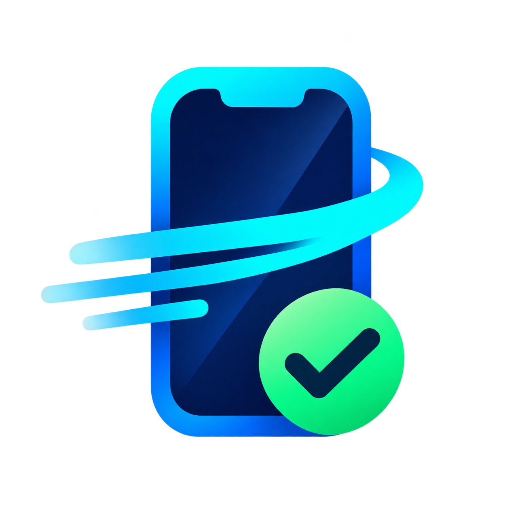

<div align="center">
  
  <h1>fast-ios-device-test</h1>
  <p><strong>Fast, repeatable iOS UI-flow verification for AI coding agents.</strong></p>
  <p>One JSON flow → Simulator or iPhone → PASS/FAIL, video, screenshots and PR evidence.</p>

  <p>
    <a href="https://www.npmjs.com/package/fast-ios-device-test"></a>
    <a href="https://github.com/DungVC-Dev/fast-ios-device-test/releases"></a>
    
    
  </p>

  <p>
    
    
    
    
  </p>
</div>

> ⚡ **Simulator** · 📱 **Physical iPhone** · 🎥 **Video review** · 🧾 **PR evidence** · 🛡️ **Guarded destructive actions**

```bash
npx fast-ios-device-test
```

<p align="center">
  <a href="#what-it-does">✨ What it does</a> ·
  <a href="#requirements">📋 Requirements</a> ·
  <a href="#install">📦 Install</a> ·
  <a href="#usage">🚀 Usage</a> ·
  <a href="#whats-new">🆕 What's new</a> ·
  <a href="#contributing">🤝 Contributing</a>
</p>

## What it does

| Tool | What it does |
|---|---|
| `fastSimulatorTest` | Drives the app on Simulator through a JSON flow (fresh install, injected UserDefaults, PASS/FAIL line). Fans out one agent per simulator for a matrix. |
| `fastDeviceTest` | Runs the same JSON flow on a physical iPhone through a cached, auto-signed XCUITest runner; can also drive Settings, Shortcuts and SpringBoard. |
| `fastUIReview` | Builds contact sheets from a recorded session so every case's video is reviewed, not just its PASS line. |
| `fastUIMap` | Prints what earlier runs saw of an app; `--path-to <screen>` gives the way there as one request. |
| `fastEvidenceSheet` | Renders the captioned PR evidence sheet again after an edit. |
| `fastUIClean` | Lists, then deletes, the caches and test builds the tools leave. |

Step by step, without writing a flow: `fastSimulatorTest do '<action or array>'` and
`fastDeviceTest do …` act on what is on screen and print the labels after the actions; `expect`
guards let one request carry several steps. In Claude Code the `ui-explorer` subagent (Haiku)
runs long searches.

Every PASS flow run, and every `--before` run that failed at its outcome step, is filed as PR
evidence in `~/Desktop/<project> <ticket>/` (the ticket from the git branch): one captioned
sheet, the clips, and light per-shot JPEGs. A filed run keeps only its `metrics.json` under
`build/`. Both engines record with `--record` (the iPhone through XCTest's own screen recording)
and keep the clip at review quality (H.264, 960 px, ~1–2 MB for 20 s).

No setup per project: the engines read everything from the flow JSON the agent writes (scheme,
bundle id, simulator, build folder); the skill shows the smallest complete flow.

## Requirements

- A Mac with Xcode 26 or 27.
- Node.js 18+ only for the `npx` install.
- AXe 1.8.0 (the Simulator driver) is bundled, so neither Homebrew nor xcodegen is needed.
- Pillow is installed when possible; only video review (`fastUIReview`, `fastEvidenceSheet`, the
  `motion` action) needs it.
- For a physical iPhone: see [GUIDE.md](GUIDE.md) (Vietnamese) or [SETUP.md](SETUP.md).

## Install

Install the plugin for your agent, then install the local Xcode runtime once. Pick the agent you
use below — Codex and Antigravity are first-class packages, not manual skill copies.

### 1. Add it to your agent

#### Codex Plugin Marketplace

**Install now from the repository marketplace:**

```bash
codex plugin marketplace add DungVC-Dev/fast-ios-device-test
codex plugin add fast-ios-device-test@fast-ios-device-test
```

Restart Codex after installation.

**When the public listing goes live:** start `codex`, run `/plugins`, search for
**Fast iOS Device Test**, select it and choose **Install plugin**. The universal directory package
is ready for submission but is not listed yet.

#### Antigravity Plugin Store

**Install now directly from GitHub:**

```bash
agy plugin install https://github.com/DungVC-Dev/fast-ios-device-test
agy plugin list
```

Restart Antigravity after installation.

**When the official listing goes live:** open **Customizations → Marketplace** in the Antigravity
app, or run:

```bash
agy plugin install fast-ios-device-test@antigravity-plugins-official
```

The curated marketplace package is ready for submission but is not listed yet.

#### Gemini CLI Extension

```bash
gemini extensions install https://github.com/DungVC-Dev/fast-ios-device-test
```

#### Claude Code Plugin Marketplace

```text
/plugin marketplace add DungVC-Dev/fast-ios-device-test
/plugin install fast-ios-device-test@fast-ios-device-test
```

> **Store status:** Codex repository-marketplace, Antigravity GitHub-plugin and Gemini CLI direct
> installs are available now. Public Codex and curated Antigravity bundles are submission-ready,
> but are not live in their official directories yet.

### 2. Install the local runtime

The plugin teaches the agent how to use the tool. The runtime supplies the Xcode engines, AXe and
launchers on your Mac. Pick one installation method:

| Way | Commands | Tool folder (`$TOOL` below) |
|---|---|---|
| **npx** (recommended) | `npx fast-ios-device-test` (run again to upgrade) | `~/.local/share/fast-ios-device-test` |
| **git clone** (to edit the tool) | `git clone https://github.com/DungVC-Dev/fast-ios-device-test.git ~/fast-ios-device-test`<br>`~/fast-ios-device-test/install.sh --link` | the clone, e.g. `~/fast-ios-device-test` (keep it; upgrade with `git -C ~/fast-ios-device-test pull`) |
| **Release zip** (no Node.js, no git) | Download `fast-ios-device-test-<version>.zip` from [Releases](https://github.com/DungVC-Dev/fast-ios-device-test/releases), unzip, run its `install.sh` | `~/.local/share/fast-ios-device-test` (the unzipped folder can be deleted) |

npx copies the tool out of its temporary folder, so it keeps working after npx cleans up.

What the installer puts where:

| What | Where |
|---|---|
| The tool | `~/.local/share/fast-ios-device-test` (or your clone with `--link`) |
| Launchers `fastSimulatorTest`, `fastDeviceTest`, `fastUIReport`, `fastUIReview`, `fastEvidenceSheet`, `fastUIMap`, `fastUIClean` | `~/.local/bin` (add it to `PATH` if the installer says so) |
| AXe, when none ≥ 1.8.0 is on `PATH` | `~/.local/share/axe` |
| Claude Code skill | `~/.claude/skills/fast-ios-device-test` |
| Claude Code slash commands `/fastSimulatorTest`, `/fastDeviceTest`, `/fastUIReview` | `~/.claude/commands` |
| Claude Code `ui-explorer` subagent | `~/.claude/agents` |

### 3. Check

```bash
npx fast-ios-device-test --check                           # what is there and what is missing; changes nothing
npx fast-ios-device-test --check --device "<iPhone name>"  # also checks that iPhone for fastDeviceTest
```

From a clone or the zip, run `install.sh --check` instead. The last line is `CHECK OK`, or
`CHECK missing: …` with the fix for each item.

<details>
<summary><strong>Development install: link a local clone into Codex or Antigravity</strong></summary>

```bash
TOOL=~/fast-ios-device-test

# Codex
mkdir -p ~/.codex/skills
ln -sfn "$TOOL/skills/fast-ios-device-test" ~/.codex/skills/fast-ios-device-test

# Antigravity
mkdir -p ~/.gemini/antigravity-cli/skills
ln -sfn "$TOOL/skills/fast-ios-device-test" ~/.gemini/antigravity-cli/skills/fast-ios-device-test
```

Restart the agent after linking. Codex loads the skill when a request matches it or when you name
`$fast-ios-device-test`; Antigravity and Gemini CLI load it on demand from its description.

</details>

<details>
<summary><strong>Maintainers: build marketplace submission bundles</strong></summary>

Run `python3 scripts/package_marketplaces.py`. Clean Codex, Antigravity and Gemini CLI staging
folders and ZIPs are written under `build/plugin-packages/`. Before submission, validate the
Antigravity bundle with:

```bash
agy plugin validate --strict build/plugin-packages/stage/antigravity
```

</details>

#### Optional: Apple's own tools

For exploring a screen with Xcode 27's tools (pinch, drag, rotate, app console log) before
writing a flow, register its MCP server once, e.g. in Claude Code:
`claude mcp add xcode -- xcrun mcpbridge`. The skill says when to use which.

## Usage

Describe the screen or flow in words; the agent writes the flow (or steps through it), runs it and
reports PASS/FAIL with screenshots.

In Claude Code:

```
/fastSimulatorTest open the Lyrics tab as a premium user, take a screenshot
/fastSimulatorTest the Home screen, in light and dark mode, with video
/fastDeviceTest on my iPhone: open Home, check that no paywall shows
/fastUIReview <session>
```

In Codex or Antigravity CLI, ask the same in plain words, for example *"Use fast-ios-device-test
to open the Lyrics tab on Simulator as a premium user and take a screenshot"*. The agent runs
the launchers (`fastSimulatorTest`, `fastDeviceTest`, …) itself.

More examples and everything a tester needs to know (gestures, timing, safety rules, keyboards):
[GUIDE.md](GUIDE.md) (Vietnamese).

## Clean caches and test builds

The tools leave builds and run output behind; this deletes them and keeps the tool installed.
It lists what would go with sizes, and deletes only with `--yes`:

```bash
npx fast-ios-device-test clean                          # list: iPhone runner build, helpers, idle locks, sessions
npx fast-ios-device-test clean --project ~/MyApp --yes  # also that project's runs and test builds
npx fast-ios-device-test clean --maps --yes             # also the screen maps fastUIMap prints
npx fast-ios-device-test clean --project ~/MyApp --scope current --yes   # only the current task's runs
npx fast-ios-device-test clean --project ~/MyApp --scope others --yes    # every task's runs but the current one
```

`fastUIClean` is the same command once installed.

A task is a flow: its runs sit in `build/fast-ui/<task>/` and `build/fast-device/<task>/`
(`home@dark` counts as `home`). The current task is the one with the latest run, or
`--task <name>`. `--scope others` keeps the test builds and the tools' caches, which the current
task still uses. Run in a terminal with `--project` and no `--scope`, it asks which of the three
and confirms before deleting.

`--project <root>` adds `build/fast-ui` and `build/fast-device` (runs, screenshots, videos),
`build/fast-ui-dd` (the Simulator app builds, the flows' `derived_data` by convention) and
`build/fast-device-tests` (the iPhone test builds). Evidence on the Desktop is never touched; a
simulator a flow is using, a running iPhone runner and the journal a killed run left for its
repair are skipped and named. A flow whose `derived_data` points elsewhere keeps that folder:
delete it yourself.

## Uninstall

```bash
npx fast-ios-device-test --uninstall      # or install.sh --uninstall from a clone
```

Removes the Claude Code skill, slash commands and subagent, the launchers (only links that point
at this tool), the copied tool in `~/.local/share/fast-ios-device-test` and the bundled AXe (a
Homebrew `axe` stays). A clone used with `--link` stays where it is. Caches, screen maps and each
project's `build/` output stay: run `clean` first to remove them too.

It also removes a Codex or Antigravity skill link that points into that copy or at nothing. A
link to a clone that still exists is yours to remove:

```bash
rm -f ~/.codex/skills/fast-ios-device-test ~/.gemini/antigravity-cli/skills/fast-ios-device-test
```

## What's new

See [CHANGELOG.md](CHANGELOG.md). 1.11 installs with `npx`, adds `fastUIClean`, `start` / `do` /
`save` sessions that build a flow on the live app, controls (`set_switch`, `set_slider`,
`set_picker`, `tap_alert`), assertions (`assert_value`, `assert_count`), device state
(appearance, location, permissions, clipboard, status bar), skips SwiftLint in test builds, and
stops `scroll_to` at the end of a list. 1.10.0 locks the iPhone and shuts simulators down at the
end of the work. 1.9.0 waits for a still screen before each screenshot. 1.8.0 adds
`two_finger_drag` on an iPhone. 1.7.0 files every passing run as PR evidence in one folder per
ticket on the Desktop. 1.6.0 reaches a screen visited before in one request (`fastUIMap
--path-to`). 1.5.0 makes step-by-step runs fast on both engines. 1.4.0 adds the gestures a tester
uses and a screen map recorded from normal runs.

## Contributing

Each coding agent loads its own guidance file from the repo root:

| File | Read by |
|---|---|
| `AGENTS.md` | Codex (and Antigravity CLI) |
| `CLAUDE.md` | Claude Code |
| `GEMINI.md` | Antigravity CLI (Antigravity-only notes; the shared facts come from `AGENTS.md`) |

`AGENTS.md` and `CLAUDE.md` carry the same project facts: change both together.

Run the tests before a commit:

```bash
(cd scripts && python3 -m unittest test_fast_ui test_fast_media test_fast_ui_map test_fast_guard test_fast_ui_clean)
```

Releases: write what changed under `## Unreleased` in CHANGELOG.md, then `./release.sh patch` (or
`minor`, `major`, `X.Y.Z`). It sets the version, runs the tests, commits, tags and pushes; GitHub
Actions then publishes to npm and creates the GitHub release with the zip.

## Repository contents

- `AGENTS.md`, `CLAUDE.md`, `GEMINI.md`: guidance for agents editing this repo
- `README.md`, `GUIDE.md` (Vietnamese, for testers), `SETUP.md` (setup an AI agent can follow, with checks and fixes), `CHANGELOG.md`
- `plugin.json`, `.agents/plugins/`: portable Codex plugin + marketplace catalog
- `.antigravity-plugin/`, `gemini-extension.json`: Antigravity plugin + Gemini CLI extension
- `.claude-plugin/`: Claude Code plugin + marketplace manifests
- `package.json`, `npm/install.js`: the npm package behind `npx fast-ios-device-test`
- `install.sh`: installer (`--link`, `--check`, `--uninstall`)
- `skills/fast-ios-device-test/SKILL.md`: agent instructions (flow file, single flow, several flows or simulators)
  - `references/device.md`: fastDeviceTest on a physical iPhone
  - `references/review.md`: reviewing recorded runs with fastUIReview
  - `references/usage.md`: flow action reference, matrix, cache model, troubleshooting
- `commands/`: the three Claude Code slash commands
- `agents/ui-explorer.md`: Claude Code Haiku subagent for long step-by-step searches (experimental)
- `bin/`: launcher symlinks for the plugin install
- `scripts/fast_ui.py`: Simulator flow engine (`scripts/test_fast_ui.py` tests it); `--record`, `--session`
- `scripts/fast_device.py` + `device-runner/`: physical-iPhone flow runner (XCUITest, auto-signed; the `.xcodeproj` is committed, regenerate with `cd device-runner && xcodegen generate` after editing `project.yml`)
- `scripts/fast_ui_report.py`: collates a fan-out session into a flow × simulator table (`fastUIReport`)
- `scripts/fast_ui_review.py`: contact sheets and review notes for recorded runs (`fastUIReview`)
- `scripts/fast_evidence.py`: files each qualifying flow run into the ticket's evidence folder, shared by both engines (`scripts/test_fast_evidence.py`)
- `scripts/fast_evidence_sheet.py`: captioned evidence sheet for a PR (`fastEvidenceSheet`; `scripts/test_fast_evidence_sheet.py`)
- `scripts/fast_ui_clean.py`: `fastUIClean` (`scripts/test_fast_ui_clean.py`)
- `scripts/fast_ui_map.py`: screen map recorded from both engines' runs, and its `fastUIMap` launcher (`scripts/test_fast_ui_map.py`)
- `scripts/fast_guard.py`: checks a `do` request before it runs (destructive steps, shapes), shared by both launchers (`scripts/test_fast_guard.py`)
- `scripts/fast_media.py`: review-quality video re-encode and the one-final-clip rule, shared by both engines (`scripts/test_fast_media.py`)
- `vendor/`: the AXe release tarball `install.sh` unpacks when no `axe` ≥ 1.8.0 is on PATH (MIT, see `vendor/AXe-LICENSE`)
