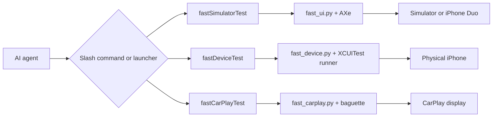

<div align="center">
  
  <h1>fast-ios-device-test</h1>
  <p><strong>Fast, repeatable iOS UI-flow verification for AI coding agents.</strong></p>
  <p>One JSON flow. Simulator, iPhone, iPhone Duo, or CarPlay. Clear results and reviewable evidence.</p>

  <p>
    <a href="https://www.npmjs.com/package/fast-ios-device-test"></a>
    <a href="https://www.npmjs.com/package/fast-ios-device-test"></a>
    
    
    <a href="#license-and-credits"></a>
  </p>

  <p>
    <a href=".claude-plugin/plugin.json"></a>
    <a href="plugin.json"></a>
    <a href="gemini-extension.json"></a>
    <a href=".antigravity-plugin/plugin.json"></a>
  </p>
</div>

## How you use it

You talk to your agent. The agent writes the flow, runs the engine and reports back. You do not
type `flow.json` commands yourself.

**Slash commands** (Claude Code):

| You want to… | Type in Claude Code |
|---|---|
| Check a screen on Simulator | `/fastSimulatorTest the Settings screen opens General and shows About` |
| Check it on a real iPhone | `/fastDeviceTest login flow on my iPhone, record a video` |
| Check iPhone Duo | `/fastSimulatorTest Home screen on iPhone Duo, closed and open` |
| Check CarPlay | `/fastCarPlayTest lyrics widget shows on the CarPlay screen, small display too` |
| Review recordings | `/fastUIReview last session` |

**Any agent** (Claude Code, Codex, Antigravity, Gemini CLI): just ask in plain words. The
`fast-ios-device-test` skill picks it up.

> *"Test the paywall on Simulator in dark mode and record it."*
> *"Kiểm tra màn Settings trên iPhone thật, quay video giúp tôi."*
> *"Run the CarPlay browse case CPB-01 on the CarPlay Simulator."*

You get one PASS/FAIL line per case, screenshots, an optional video and the cause of any failure.

## Install in 30 seconds

```bash
npx fast-ios-device-test
npx fast-ios-device-test --check
```

The installer provides the launchers and Claude Code integration; the repository also ships Codex,
Gemini CLI, and Antigravity packages. It installs the required AXe and optional CarPlay tool
`baguette` from versions pinned in [`vendor/tools.json`](vendor/tools.json), with SHA-256
verification. Homebrew is not required.

Update the package and managed tools independently:

```bash
npx fast-ios-device-test update
npx fast-ios-device-test update-tools
```

From a clone, use `./install.sh --check`. A missing `baguette` is reported but does not fail the
check; install it later with
`./install.sh --install-baguette` when CarPlay testing is needed.

## Add it to your agent

The runtime above gives you the engines and launchers. The plugin teaches your agent how to use
them. Pick your agent:

| Agent | Install | Then |
|---|---|---|
| **Codex** | `codex plugin marketplace add DungVC-Dev/fast-ios-device-test`<br>`codex plugin add fast-ios-device-test@fast-ios-device-test` | Restart Codex |
| **Antigravity** | `agy plugin install https://github.com/DungVC-Dev/fast-ios-device-test` | `agy plugin list`, restart Antigravity |
| **Gemini CLI** | `gemini extensions install https://github.com/DungVC-Dev/fast-ios-device-test` | Restart Gemini CLI |
| **Claude Code** | `/plugin marketplace add DungVC-Dev/fast-ios-device-test`<br>`/plugin install fast-ios-device-test@fast-ios-device-test` | Optional, see below |

> [!NOTE]
> **Claude Code needs no plugin.** `npx fast-ios-device-test` already links the skill, the slash
> commands and the subagent into `~/.claude`. Add the plugin only if you want to manage it with
> `/plugin`; with both, Claude Code lists the skill and the commands twice.

<details>
<summary>Store status</summary>

Codex repository-marketplace, Antigravity GitHub-plugin and Gemini CLI direct installs work now.
The public Codex directory listing and the curated Antigravity listing
(`agy plugin install fast-ios-device-test@antigravity-plugins-official`) are submission-ready but
not live yet. When they are, install from Codex `/plugins` (search **Fast iOS Device Test**) or
Antigravity **Customizations → Marketplace**.

</details>

## How a run works



Flows are versioned JSON. Each engine prints one result line and stores screenshots, metrics, and
failure evidence under the flow's artifact root.

## What each command does

Each command works the same way: you describe the behavior, the agent writes a JSON flow, runs it,
and answers with one result line per case plus the evidence.

### `/fastSimulatorTest`: Simulator

```text
/fastSimulatorTest Settings opens General and shows About, in dark mode, record it
```

The agent builds the app once, drives the Simulator through AXe and replies:

```text
PASS task=settings-general@dark total=9.9s build=skip artifacts=file:///…/settings-general@dark/
```

A failure names the step and the cause (`FAIL … step=03_wait error=…`) next to a screenshot and the
screen labels it saw. Ask for *dark mode*, *larger text* or *record it* in plain words; the agent
maps them to `--appearance`, `--content-size` and `--record`.

<details>
<summary>Flow the agent writes</summary>

```json
{
  "version": 1,
  "name": "settings-general",
  "app": {
    "project_root": "/absolute/path/to/project",
    "bundle_id": "com.apple.Preferences",
    "simulator": "iPhone 17 Pro",
    "prebuilt": true
  },
  "actions": [
    {"type": "launch"},
    {"type": "wait", "label": "General"},
    {"type": "screenshot", "name": "general.png"}
  ]
}
```

Run by hand: `fastSimulatorTest flow.json [--record] [--session <name>] [--appearance light|dark] [--content-size <size>]`. Step by step: `fastSimulatorTest start | do | labels | save`.
</details>

### `/fastDeviceTest`: physical iPhone

```text
/fastDeviceTest login works on my iPhone, record a video
```

Same flows, run on the cabled iPhone by a cached, auto-signed XCUITest runner. Settings, Shortcuts
and SpringBoard work too.

```text
PASS task=login device=My iPhone mode=server total=14.2s artifacts=file:///…/login/
```

<details>
<summary>Flow the agent writes</summary>

```json
{
  "version": 1,
  "name": "device-home",
  "app": {
    "project_root": "/absolute/path/to/project",
    "bundle_id": "com.example.app",
    "device": "My iPhone"
  },
  "actions": [
    {"type": "launch"},
    {"type": "wait", "label": "Home"},
    {"type": "screenshot", "name": "home.png"}
  ]
}
```

Run by hand: `fastDeviceTest flow.json --device <name-or-udid> [--install <app>] [--record] [--session <name>]`.
</details>

### iPhone Duo

```text
/fastSimulatorTest the Home screen on iPhone Duo, closed and open
```

The agent drives Device Hub (Xcode 27.1): `closed` shows the outer display, `open`, `book` and
`tabletop` the inner one, and each screenshot comes from the display in use. One result row per
pose (`@duo-closed`, `@duo-open`).

<details>
<summary>Flow the agent writes</summary>

```json
{
  "version": 1,
  "name": "duo-displays",
  "app": {
    "project_root": "/absolute/path/to/project",
    "bundle_id": "com.apple.Preferences",
    "simulator": "iPhone Duo",
    "prebuilt": true
  },
  "actions": [
    {"type": "launch"},
    {"type": "duo", "pose": "closed"},
    {"type": "screenshot", "name": "outer.png"},
    {"type": "duo", "pose": "open"},
    {"type": "screenshot", "name": "inner.png"}
  ]
}
```

Run by hand: `fastSimulatorTest flow.json --duo-pose closed|open|book|tabletop`.
</details>

### `/fastCarPlayTest`: CarPlay

```text
/fastCarPlayTest the lyrics widget shows on the CarPlay screen
/fastCarPlayTest same check on the small 800×480 display
/fastCarPlayTest CPR-01 on the CarPlay Simulator with my iPhone
```

- **Simulator**: Xcode's CarPlay window on a throwaway `agent-tmp-*` simulator, driven by baguette.
  Widescreen 1920×720 by default; ask for the *small* (800×480) or *HD* display when you need it.
  One size per run.
- **Hardware**: Apple's CarPlay Simulator with your iPhone on USB, including connect/disconnect
  cases. An "Automaker UI" screen means CarPlay was not connected: the case is `VOID`, not `FAIL`.

```text
PASS task=lyrics-widget target=sim total=17.5s artifacts=file:///…/lyrics-widget/
```

<details>
<summary>Flow the agent writes</summary>

```json
{
  "version": 1,
  "name": "carplay-home",
  "app": {
    "project_root": "/absolute/path/to/project",
    "bundle_id": "com.example.app",
    "simulator": "agent-tmp-carplay",
    "prebuilt": true
  },
  "setup": {
    "carplay_display": "widescreen",
    "carplay_arm_script": "/absolute/path/to/project/tools/carplay_sim_display.sh"
  },
  "actions": [
    {"type": "launch"},
    {"surface": "car", "type": "car_wait_stable", "name": "CarPlay ready"},
    {"surface": "car", "type": "car_screenshot", "name": "car-home.png"}
  ]
}
```

Run by hand: `fastCarPlayTest doctor --target sim|hardware` and `fastCarPlayTest run flow.json --target sim|hardware [--display widescreen|standard|hd|WxH@S] [--udid|--device] [--record]` (`--record`: hardware only).
</details>

### `/fastUIReview`: review and report

```text
/fastUIReview last session
```

Contact sheets of every recorded case (needs Pillow), and a PASS/FAIL table across flows, variants
and devices from `fastUIReport`.

### Several cases at once

Ask for them in one message: *"check this screen in light and dark, normal and largest text"*.
The agent runs one variant per run in a shared session and answers with one table. It adds only the
variants you ask for.

## Reference

<details>
<summary><strong>Repository layout</strong></summary>

| Path | Purpose |
|---|---|
| `scripts/fast_ui.py` | Simulator and iPhone Duo engine |
| `scripts/fast_device.py` | Physical-iPhone engine |
| `scripts/fast_carplay.py` | Simulator and hardware CarPlay engine |
| `device-runner/` | Cached XCUITest runner project |
| `skills/fast-ios-device-test/` | Agent skill, examples, and detailed action reference |
| `commands/` | Claude Code slash commands |
| `vendor/tools.json` | Pinned versions, URLs, checksums, and licenses |
| `build/fast-ui/` | Default Simulator artifacts |
| `build/fast-device/` | Default physical-device artifacts |
| `build/fast-carplay/` | Default CarPlay artifacts |

</details>

<details>
<summary><strong>Environment variables</strong></summary>

| Variable | Purpose |
|---|---|
| `FAST_SIMULATOR` | Default Simulator UDID for step-by-step commands |
| `FAST_UI_APP` | Default bundle identifier for Simulator step-by-step commands |
| `FAST_DEVICE` | Default physical iPhone name or UDID |
| `FAST_UI_ROOT` | Simulator artifact root |
| `FAST_DEVICE_ROOT` | Physical-device artifact root |
| `FAST_UI_SESSION` | Shared report and review session name |
| `FAST_IOS_AXE_DIR` | Managed AXe installation directory |
| `FAST_IOS_BAGUETTE_DIR` | Managed `baguette` installation directory |
| `FAST_IOS_BIN_DIR` | Launcher and managed-tool wrapper directory |
| `FAST_IOS_INSTALL_DIR` | Runtime installation directory |
| `FAST_IOS_NO_UPDATE_CHECK=1` | Disable background package and tool update checks |
| `DUO_XCODE` | Override the Xcode 27.1 application used for iPhone Duo |

</details>

<details>
<summary><strong>Troubleshooting</strong></summary>

- **Duo device missing:** open Xcode 27.1 and install its requested additional components and iOS
  runtime. Device Hub, not the older Simulator app, owns the iPhone Duo window.
- **Duo pose does not change:** allow the terminal or agent under **System Settings → Privacy &
  Security → Accessibility**, then reopen the Duo device in Device Hub.
- **CarPlay display is stuck:** after installing or replacing an app, relaunch Apple's standalone
  CarPlay Simulator. The hardware engine does this before waiting for its window.
- **`baguette` is missing:** it is optional and used only by Simulator CarPlay runs. Install the
  verified pin with `./install.sh --install-baguette`. The released binary is arm64-only.
- **A check fails:** run `./install.sh --check`. It prints each missing item and its repair command.

For guided setup, see [SETUP.md](SETUP.md). Testers can use the Vietnamese [GUIDE.md](GUIDE.md).
Release history is in [CHANGELOG.md](CHANGELOG.md).

</details>

## License and credits

This repository does not currently declare a project-wide license. Managed third-party tools keep
their upstream licenses:

- [AXe](https://github.com/cameroncooke/AXe) by Cameron Cooke — MIT; see
  [`vendor/AXe-LICENSE`](vendor/AXe-LICENSE).
- [baguette](https://github.com/tddworks/baguette) by TDDWorks — Apache-2.0; see
  [`vendor/baguette-LICENSE`](vendor/baguette-LICENSE).
